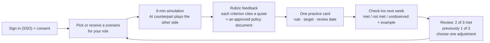
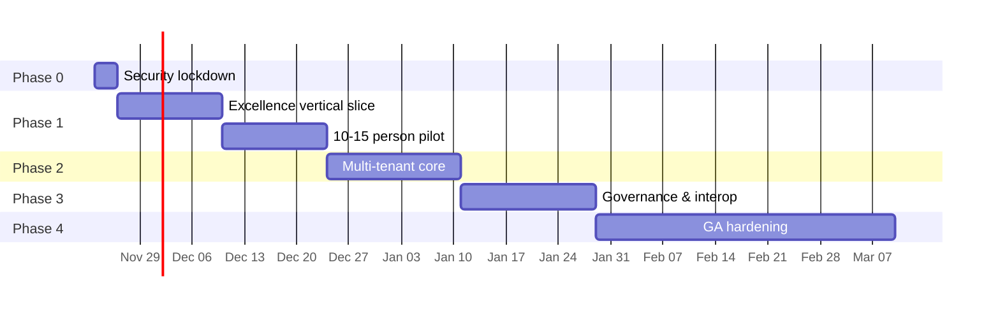
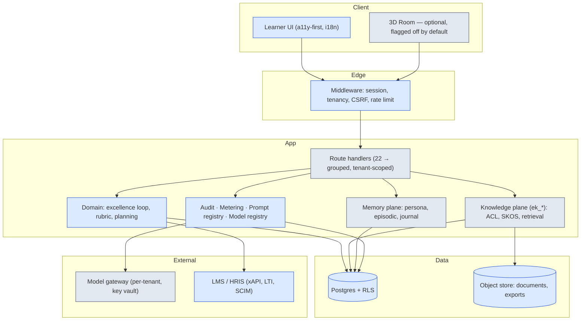

# Coworkerz → Employee Excellence Stimulator

**Enterprise-grade product plan · v1 · 2026-11-20**

Scope: turn the current **Aether 3D Executive Suite** (a trusted, single-user CEO console) into an **enterprise product that measurably stimulates employee excellence**. This document is a plan, not a claim of implemented work. Every "current state" statement below was verified against the checkout at `816d190` today; every "target" statement is proposed.

---

## 0. Verdict in one screen

| Question | Answer |
| --- | --- |
| Is the current code good? | **Yes, unusually so for a prototype.** `tsc` clean, `eslint .` clean, `npm test` 30/30 pass, disciplined migrations, real ADRs, honest docs that distinguish measured from claimed. |
| Is it enterprise-ready? | **No — and not because of missing features.** It is single-tenant, single-user, and *fails open*. A fresh install served to the network answers every request as the CEO to any anonymous caller (§2.1, reproduced today). |
| Biggest strategic asset | **The governed-knowledge plane** (`ek_*`: SKOS taxonomy, clearance levels, item ACLs, review workflow, provenance, hashed API keys, OpenAPI). This is what enterprise L&D buyers cannot buy off the shelf. |
| Biggest strategic liability | **The product's centre of gravity is the 3D boardroom.** It is a demo magnet and an enterprise blocker: accessibility, GPU cost, and zero procurement value on its own. |
| Real distance to a credible enterprise pilot | **~12 weeks** with 2 engineers + 1 designer. **~6–9 months solo.** |
| Ranked blockers | 1. Fails open (days to fix) → 2. No tenant/user model (weeks) → 3. No excellence loop at all (the actual product) → 4. No governance/metering/audit (weeks) → 5. Scale & ops (weeks). |

**The single most important reframe:** the current app measures *conversation activity* and says so honestly ([ADR-001](decisions/0001-personal-excellence.md)). An "excellence stimulator" that ships conversation activity as excellence will be rejected by HR buyers, works councils and, in the EU, regulators. The product must be built on **practiced behaviour with dated evidence**, not on message counts or persona scores.

---

## 1. What exists today, precisely

### 1.1 Inventory (verified)

| Dimension | Current value |
| --- | --- |
| Stack | Next.js 16.4.2 App Router, React 19, TypeScript 5.9, Drizzle ORM 0.45, `better-sqlite3` 13 |
| Tables | 19 (`seed_runs`, 7 deliberation/memory tables, 11 `ek_*` knowledge tables) |
| Route handlers | 22 under `src/app/api` |
| Non-unique indexes | **0** — a single partial unique index exists on active executive title |
| Sync `better-sqlite3` calls (`.get()/.all()/.run()`) | **115** — the Postgres port is a real migration, not a config flag |
| Authentication | **None.** `resolvePrincipal` returns a CEO principal when no credential is present |
| Authorization | Good *within* the knowledge plane (`canPrincipalRead`, clearance ranks, ACLs). Absent *between* users — there is no user |
| Tenancy | Implicit single tenant, enforced by schema (`single_ceo_baseline` has `CHECK (id = 1)`) |
| Secrets | Provider API key stored as plaintext in `opencode_configs.api_key`; masked only in the API response |
| Provider resilience | Single attempt, `AbortSignal.timeout(45_000)`, no retry/backoff/circuit breaker/idempotency |
| Rate limiting / quotas | **None** |
| Metering / cost attribution | **None** — no token or cost accounting anywhere |
| Audit log | **None** (the `aclAudit` field is a per-response redaction counter, not a durable trail) |
| Observability | 35 `console.*` calls; no structured logs, metrics, tracing, error tracking, SLOs |
| CI/CD | **No `.github/`**, no Dockerfile, no IaC, no dependency/SBOM scanning |
| Accessibility | One scoped axe run recorded (17 rules pass, 1 incomplete). No screen-reader path for the 3D canvas, no no-WebGL fallback |
| i18n | None (single `lang="en"`) — relevant given the Indonesia deployment target |
| Evaluation | Strong *doctrine* (`docs/turn-evaluation.md`) with synthetic fixtures; no automated regression gate on model output |

### 1.2 The quality floor is real

Do not rebuild this. Preserve these properties through every phase:

- Migrations are explicit, immutable, reviewed, and tested against populated legacy fixtures.
- The UI/API/renderer boundary is documented and actually respected.
- Claims are separated from evidence ("a local synthesis turn is not a live-model test").
- Provider I/O happens outside the SQLite write lock, with a revalidation transaction that discards stale output on conflict.
- The knowledge and memory planes are deliberately, defensibly separate, and retrieval treats document text as data, never as instructions.

That last point is the seed of a genuine enterprise security posture. It needs to become a tested property, not a design note (§4.3).

---

## 2. Findings that change the plan

### 2.1 F-01 — The console fails open (Critical)

**Method:** fresh `db:setup` into a throwaway directory, `next dev -H 0.0.0.0`, no credentials sent.

| Probe | Result |
| --- | --- |
| `GET /api/boardroom` | **200** — full transcript, CEO directives, enterprise stats |
| `GET /api/executive-profiles` | **200** — whole roster incl. every `skillPrompt` |
| `GET /api/opencode-config` | **200** |
| `GET /api/v1/enterprise/documents` | **200** — includes `board_restricted` "MEMO-501: Project Kestrel $38M M&A Valuation" and `confidential` pending-review documents |
| `POST /api/knowledge` | **200** — created note id 5 |
| `DELETE /api/knowledge?id=1` | **200** `{"ok":true}` |
| `PUT /api/executive-profiles/CTO` | **200** — `skillPrompt` replaced, **persisted**, confirmed by re-read |

**This is documented behaviour, not a regression.** `docs/executive-roster.md:13` says the console "assumes a trusted CEO" and warns not to expose it. `AGENTS.md` repeats it. The code honours the assumption. But the assumption is incompatible with the word "enterprise", and it silently converts an internal demo into a data-exfiltration and prompt-poisoning surface the moment it is reachable by more than one person.

Note the last row in particular: overwriting a `skillPrompt` is **persistent prompt injection against every future turn by that executive**, with no audit trail. Combined with `board_restricted` document retrieval, an unauthenticated attacker can rewrite the CFO's instructions and then read what it retrieves.

**Fix window: 3 days. Do this before any other work (§4.1).**

### 2.2 F-02 — There is no employee

The schema's unit of identity is an *AI executive* plus one implicit human ("CEO"). An excellence product's unit of identity is a **person with a manager, a competency rubric, a consent record and a longitudinal history**. Setting `single_ceo_baseline` aside, the pattern repeats: `ceo_persona` is a singleton, `ceo_signal_baseline` has `CHECK (id = 1)`, and `resolvePrincipal` has no fallback branch for "who is this person".

This is the largest code change in the plan, and it is unavoidable. It is also mostly mechanical if scoped to a vertical slice first (§4.2).

### 2.3 F-03 — The thing being measured is not excellence

`persona-topic-signals.ts` counts keyword hits and maps them to `38 + hits*6 + msgsWith*7`. `appliedCount` increments when a note is *selected as context*, not when a human acts on it. [ADR-001](decisions/0001-personal-excellence.md) is correct and unusually honest about this, and it proposes the right primitive:

> rule → baseline → target → review date → **dated self-reported check-ins** → adjustment

**ADR-001 is the product.** It is currently scoped to "one willing CEO" and unimplemented. The enterprise plan is to generalise exactly that loop from one person to a workforce — and to *deliberately refuse* to generalise the radar.

> **Rule that must survive contact with sales:** no manager-facing surface may display a score derived from message frequency, topic keywords, or model-generated sentiment. If a number reaches a manager, that number must be traceable to a rubric version, a dated observation, and a named evidence artefact.

### 2.4 F-04 — Excellent knowledge plane, no operating envelope around it

The `ek_*` plane has clearance ranks, item ACLs, graph-endpoint visibility checks, `pending_review` exclusion from retrieval, hashed scoped API keys, and a generated OpenAPI document. What it lacks is everything an enterprise *operates* it with: durable audit, per-tenant quotas, retention, deletion, DSR export, encryption at rest, and pagination (`GET /api/v1/enterprise/documents` loads and filters the entire table in process).

### 2.5 F-05 — The 3D room is a cost with no buyer

`VirtualOfficeCanvas.tsx` is 1,541 lines, the heaviest client component, and the reason the app needs WebGL, a GPU budget and an axe exception. `docs/art-budgets.md` is thorough about *proposed* limits and honest that no device baseline exists. Hitting the documented quality gates will take a hero-art budget and per-device capture work.

For enterprise L&D procurement, the room contributes nothing to a scoring rubric. Recommendation is not to delete it — it is genuinely differentiating in a demo — but to **demote it to an optional presentation layer** behind a flag, with the domain, API and analytics working identically without it (§5.3).

---

## 3. Product definition

### 3.1 Three candidate shapes (the load-bearing decision)

| | A · Self-serve growth coach | B · Manager/HR talent assessment | **C · Role-scenario practice simulator** |
| --- | --- | --- | --- |
| Who buys | Individual | HR / CHRO | **L&D / Enablement, then HR** |
| Core loop | Practice card + reflection | Scored competency grid per employee | **Grounded scenario → rubric feedback → practice card → check-in** |
| Reuses the codebase | ADR-001 only | Radar + rubrics | **Scenario engine + `ek_*` knowledge + memory + ADR-001** |
| Reuses ADR-001's integrity stance | Fully | **Contradicts it** | **Fully** |
| Legal exposure (EU AI Act) | Minimal | **High-risk (Annex III §4: employment)** | **Low if assistive; high if it scores the person** |
| Sales cycle | Days | 9–18 months, works councils | **6–8 weeks to a pilot** |
| Defensibility | Thin | Crowded (Lattice, 15Five) | **Strong — "your own policy documents as the sim world"** |

**Recommendation: C, with A as the retention mechanic.** Scenario practice produces observable behaviour; the practice card converts behaviour into a longitudinal record the employee owns; the governed knowledge plane makes every scenario cite *the customer's own approved policy* — which is the one thing competitors cannot copy.

This also keeps the product on the safe side of AI regulation: the AI **simulates a situation and gives cited feedback to the learner**, and it does **not** produce a manager-visible judgement about a person. That single architectural choice saves a conformity assessment.

### 3.2 What the employee does (the MVP journey)



Every arrow is an analytics event from day one — that is a hard requirement, not a phase-4 nicety.

### 3.3 What the buyer/admin does

- Import people and the manager hierarchy (SCIM/CSV in phase 2; HRIS sync phase 3).
- Publish a **competency framework** (versioned rubrics mapped onto the existing SKOS taxonomy).
- Author scenarios bound to competencies and to approved `ek_documents`.
- See **aggregate adoption and learning** (completion, practice rate, second-review return rate) — never an individual "excellence index".
- Export everything (CSV/xAPI) and delete everything (DSR, retention).

---

## 4. Roadmap

Five phases. Each has a **goal**, an **exit gate that must be measured**, and an explicit "do not proceed if" condition. Gates are the plan; dates are estimates for 2 engineers + 1 designer + 0.5 PM.



### Phase 0 — Security & truth lockdown (3 days)

**Goal:** the app is safe to put behind a URL, and we no longer claim things we can't show.

| # | Work item | Files |
| --- | --- | --- |
| 0.1 | **Fail closed.** Delete the `return makeRolePrincipal("CEO", "ceo-session")` fallback. No credential ⇒ `401`. | `src/lib/enterprise-knowledge.ts:144` |
| 0.2 | **Real session.** Auth.js (or WorkOS/Clerk if you want SSO on day one) with an OIDC provider; signed, `HttpOnly`, `SameSite=Lax`, `__Host-` cookie. | new `src/lib/auth.ts`, `src/middleware.ts` |
| 0.3 | **Deny-by-default middleware** — allow only `/login`, `/api/health`, static assets. Every other path requires a verified session. | `src/middleware.ts` |
| 0.4 | **Route authz matrix test.** Table-driven: for all 22 handlers × {anonymous, other tenant, exec role} assert 401/403. This test is the regression guarantee; it must be in `npm test`. | new `scripts/authz.test.ts` |
| 0.5 | **Secrets out of the DB.** `opencode_configs.api_key` → `key_ref` + `last4`. Read from env/KMS. Migration `0005` nulls existing values and records `key_cleared_at`. Rotate any key that has ever been in a DB file. | `src/lib/model-gateway.ts`, `src/db/schema.ts`, `drizzle/0005_*.sql` |
| 0.6 | **CSRF + origin check** on all mutating routes (this repo has none, and cookies make it mandatory). | `src/lib/auth.ts` |
| 0.7 | **Rate limits + provider kill switch** — per-IP and global token bucket; refuse provider egress when no budget is configured. | `src/lib/model-gateway.ts` |
| 0.8 | **Prompt-version registry.** `skillPrompt` is currently free-text that executes as a system instruction with no version, author or history. Add `prompt_versions` + require a reason on edit. | `src/lib/executive-profile-store.ts` |

**Exit gate**
- `scripts/authz.test.ts` green: anonymous denied on **all 22** routes; no route returns data on a missing cookie.
- A `git grep` for `ceo-session` shows zero implicit grants.
- `npm test`, `npm run typecheck`, `npm run lint`, `npm run build` pass.
- **Do not proceed if** any route can be reached without a session. There is no "temporarily disabled" version of this gate.

#### Implementation status — shipped

All eight items landed. What was verified, and how:

| Item | Result | Evidence |
| --- | --- | --- |
| 0.1 Fail closed | Done. `resolvePrincipal` grants `ceo-session` only via `asCeoSession: true`, which only `readSession()` (a verified cookie) sets. | `authz.test.ts` "no default CEO principal is reachable without a verified session" |
| 0.2 Real session | Done, **without adding a dependency**: HMAC-SHA256 over JSON claims, WebCrypto in the proxy and Node `crypto` server-side. `__Host-` + `Secure` in production, plain name over http so a dev browser accepts it. | cookie-attribute test; live 307 → `/login?next=/` |
| 0.3 Deny-by-default proxy | Done as `src/proxy.ts` (Next 16 deprecates `middleware`). Unknown `/api` paths return 404, not a pass-through. | "middleware denies by default, including unknown API paths" |
| 0.4 Authz matrix | Done: `scripts/authz.test.ts`, now in `npm test`. Compares `API_ROUTE_RULES` to the filesystem, then asserts 401 for every handler. | 19 assertions, all passing |
| 0.5 Secrets out of the DB | Done as **AES-256-GCM envelope encryption** under `CW_SECRET_KEY` rather than `key_ref`+env-only, so the UI can still store a key while the file holds only ciphertext. Migration `0005` clears legacy plaintext. | proved on a real 0004 database holding `sk-legacy-LEAK-…`: after migration the column is `""` |
| 0.6 CSRF | Done: `Sec-Fetch-Site` primary, `Origin`/`Host` fallback, bearer callers exempt (no ambient credential). | cross-site POST → 403; same-origin → 200 |
| 0.7 Rate limits + kill switch | Done: sign-in budget (5 per IP per 15 min) and a provider egress budget (`CW_PROVIDER_RATE_LIMIT`), on top of the existing `OPENCODE_OFFLINE`. | throttled sign-in → 429 |
| 0.8 Prompt-version registry | Done: `executive_prompt_versions` (migration `0006`, backfilled), reason required on change, UI field, archive preserves history. | "a skill-prompt edit is versioned and requires a reason" |

**Measured gate:** `tsc` clean, `eslint .` clean, `npm test` **48/48**, `next build` succeeds with `ƒ Proxy (Middleware)` registered. The original attack replay (anonymous reads of `/api/boardroom`, `board_restricted` documents, anonymous `POST /api/knowledge`, `DELETE /api/knowledge?id=1`, and the `PUT /api/executive-profiles/CTO` prompt rewrite) now returns **401 on all ten requests**, over real HTTP, in both dev and production builds.

#### Phase 0 — still open

- **OIDC/SSO.** Phase 0 ships a single-operator access code. That is the right shape for one trusted install, not for a workforce; Phase 2 replaces it. Do not onboard external users on the access code.
- **Process-local limiters.** `src/lib/sign-in.ts` and the provider budget are per process. Multi-instance deployment must move both to shared storage.
- **Key rotation tooling.** `CW_SECRET_KEY` rotation needs a re-seal pass; the envelope has no key id yet, so rotating without re-sealing makes every stored key unreadable (safely — they fail closed).
- **Provider key never re-entered** simply means no live model call; the app reports that through the existing diagnostics.
- **Not done, deliberately:** the "truth" half of the phase name. `appliedCount` and the persona radar still measure conversation activity. Fixing that is Phase 1's rubric work, not a security change.

### Phase 1 — Excellence vertical slice (2 weeks + 2-week pilot)

**Goal:** prove one employee's behaviour actually changes, with the smallest possible schema.

Build **one** journey end to end (§3.2) for **one** competency. No manager view, no org admin, no reports.

New tables (MVP subset, matching existing conventions: integer PK, epoch-ms dates, JSON as text, booleans as 0/1):

| Table | Purpose | Key columns |
| --- | --- | --- |
| `people` | The missing identity | `id`, `external_id`, `display_name`, `role_title`, `manager_id`, `status`, `created_at` |
| `competency_frameworks` | Versioned rubric container | `id`, `version`, `title`, `status`, `published_at` |
| `competencies` | One rubric criterion | `id`, `framework_id`, `code`, `pref_label`, `behavior_anchors` (JSON: level→observable text), `skos_concept_id` (FK to the existing taxonomy) |
| `scenarios` | Practice content | `id`, `slug`, `title`, `brief`, `counterpart_brief`, `competency_ids` (JSON), `grounding_doc_ids` (JSON), `rubric_version`, `status`, `version` |
| `scenario_runs` | One attempt | `id`, `person_id`, `scenario_id`, `session_id`, `started_at`, `completed_at`, `rubric_version`, `model_manifest` (JSON) |
| `rubric_scores` | Cited feedback | `id`, `run_id`, `competency_id`, `level`, `evidence_quote`, `evidence_offset`, `rationale`, `rater_type`, `confidence` |
| `growth_plans` | ADR-001, generalised | `id`, `person_id`, `competency_id`, `rule`, `baseline_met`, `baseline_observed`, `target_met`, `target_observed`, `review_on`, `status`, `source_run_id` |
| `check_ins` | The only input to results | `id`, `plan_id`, `occurred_at`, `outcome` (`met`\|`not_met`\|`unobserved`), `example_text`, `witnessed_by` |
| `consent_records` | Employment-data consent | `id`, `person_id`, `purpose`, `version`, `granted_at`, `revoked_at` |
| `audit_log` | Append-only | `id`, `actor_id`, `action`, `resource_type`, `resource_id`, `request_id`, `meta` (JSON), `at` |
| `usage_events` | Metering from day one | `id`, `kind`, `model_id`, `tokens_in`, `tokens_out`, `cost_micros`, `at` |
| `growth_events` | Product analytics from day one | `id`, `person_id`, `event`, `props` (JSON), `at` |

**Non-negotiables inside the slice**

1. **Every rubric score carries a quote and a document id** or it is not displayed. No citation ⇒ render "insufficient evidence", not a number. This is the anti-hallucination gate and it is cheap to build now.
2. **`unobserved` is a first-class outcome.** ADR-001 is explicit; enforce it in a unit test, because "missing = zero" is the single most common way analytics products lie.
3. **`appliedCount` is not a learning metric.** Stop incrementing it on context selection, or rename it to `context_selections` in the UI. A reviewer will find it.
4. **No manager surface exists in phase 1.** The employee owns their record.
5. **Analytics events fire on the server**, not the client, so ad-blockers and the 3D toggle cannot distort the funnel.

**Pilot gate (2 weeks, 10–15 real employees, one competency)**

| Metric | Threshold to continue |
| --- | --- |
| Scenario completion | ≥ 60% |
| Practice card created | ≥ 40% of completers |
| **Returned for a second review with a dated example** | **≥ 30%** — this is the real signal |
| Feedback rated "specific and actionable" | ≥ 70% |
| Rubric scores with a valid citation | 100% |
| Manager-visible personal scores produced | **0** |

**If flat: change the loop, do not add features.** A flat result plus one useful employee-authored adjustment counts as learning. More conversation volume does not.

### Phase 2 — Multi-tenant enterprise core (3–4 weeks)

**Goal:** many organisations, safely, with an operating envelope.

| # | Work | Note |
| --- | --- | --- |
| 2.1 | **Postgres + Drizzle.** Port 115 sync calls to async. Keep SQLite as the single-user dev/demo profile if you want, but pick one schema source. | largest mechanical cost; do it *before* tenancy lands |
| 2.2 | `org_id` on every table + Postgres RLS policies + a tenant-scoped `db` accessor (no raw table import in routes). | Prevent cross-tenant reads structurally, not by review |
| 2.3 | Org / user / role model: owner, admin, manager, learner, auditor. SSO (OIDC + SAML) and SCIM. | procurement checklist |
| 2.4 | **Manager hierarchy** + cohort assignment. | no scoring surface yet |
| 2.5 | Per-tenant model gateway config, envelope-encrypted keys, model allowlist, temperature/rounds policy. | replaces the single global config |
| 2.6 | **Quotas + metering**: tokens and cost per org/user/scenario; hard caps; admin usage report. | the thing that stops a runaway invoice |
| 2.7 | **Audit log** append-only with hash chaining; every read of `board_restricted` content logged. | the thing that closes enterprise deals |
| 2.8 | **Retention + deletion**: per-entity retention policy; hard-delete job; DSR export (JSON+CSV) under 30 days; consent revocation propagates. | GDPR Art. 17/20 |
| 2.9 | **Encryption at rest** at the column level for transcripts and evidence text; disk-level at minimum. | |
| 2.10 | **Reliability**: retry with jittered backoff, circuit breaker per gateway, idempotency keys on turn creation, a durable job queue for `runMemorySync` and scenario generation. | today `after()` is best-effort |
| 2.11 | Pagination on `GET /api/v1/enterprise/documents` (loads the whole table today). | F-04 |
| 2.12 | Indexes: `conversation_messages(session_id,id)`, `executive_memories(executive_role,id)`, `ek_chunks(document_id)`, `ek_documents(domain_key,review_status)`. | currently 0 non-unique indexes |

**Exit gate**
- Cross-tenant isolation suite: for every table and every route, a tenant-B principal reading tenant-A ids gets 404/403 — including via graph traversal, retrieval, and API keys.
- Deletion test: delete a person; assert zero orphans across 12+ tables and that the audit trail survives with PII redacted.
- Load test: 50 concurrent turns, p95 < 8 s, zero SQLITE_BUSY-class errors, provider cost attributed within 1%.
- Restore drill: documented RPO ≤ 5 min, RTO ≤ 1 h, executed once and timed.

### Phase 3 — Governance, quality & interoperability (3–4 weeks)

**Goal:** survive an enterprise security questionnaire and an HR compliance review.

| # | Work | Why |
| --- | --- | --- |
| 3.1 | **Eval harness in CI**: golden set per scenario, prompt version pinned, judge rubric, regression gate blocking merge on > 2% quality drop. | the repo has doctrine; it needs a gate |
| 3.2 | **Red-team suite**: injection via document text, via `skillPrompt`, via scenario input; assert retrieval never executes instructions. | the design note becomes a test |
| 3.3 | **Model registry**: model id → provider, version, context window, cost, allowed regions, eval score. Every run stores the manifest. | reproducibility + AI Act logging |
| 3.4 | **Human-in-the-loop**: any AI score that could affect a person requires reviewer confirmation before it leaves the learner's own view. | keeps you out of high-risk classification |
| 3.5 | **Transparency**: in-product AI disclosure, per-score "why this" panel, data-subject access, opt-out. | EU AI Act Art. 50 / GDPR |
| 3.6 | **Interop**: xAPI statement emit, SCORM 1.2/2004 export, LTI 1.3 launch, HRIS sync (Workday/BambooHR), CSV/BI export. | L&D buys platforms that talk to the LMS |
| 3.7 | **Accessibility**: WCAG 2.2 AA across non-3D paths; keyboard-only scenario run; screen-reader narration of dialogue; **no-WebGL fallback that is feature-complete**. | the 3D room cannot be the only path |
| 3.8 | **i18n/l10n**: extract strings, `en` + `id` first; locale-aware rubrics (behavioural anchors do not translate literally). | Indonesia deployment |
| 3.9 | **CI/CD**: build, typecheck, lint, unit, authz matrix, Playwright, migration drift check, `npm audit`, SBOM, container image, signed releases. | there is no `.github/` today |

**Exit gate**
- Eval regression gate live and demonstrated failing on a deliberately bad prompt.
- Red-team suite green; one documented attempt at an injection attack that is blocked.
- axe clean on the no-WebGL path; keyboard-only completion of a full scenario run.
- Security questionnaire self-answered with evidence links, no "roadmap" answers on the top 20 items.

### Phase 4 — GA hardening (ongoing)

SOC 2 Type I → II readiness, third-party penetration test, DR/backup automation, on-call rotation + SLOs (availability, turn latency, provider error budget), status page, trust centre, DPA + subprocessor list, per-active-learner unit economics dashboard, support runbooks, adversarial data-quality review of rubrics with an I/O psychologist.

---

## 5. Architecture target

### 5.1 Shape



Legend: grey = exists and should be preserved; blue = must be built.

### 5.2 Keep the two-plane discipline

`AGENTS.md` forbids merging conversational notes with reviewed enterprise documents. **Preserve this in the excellence product and make it visible as a product feature**, because it is the core differentiator:

- **Plane A — Governed truth.** Approved policy, versioned, ACL'd, cited. Scenario feedback may cite it.
- **Plane B — Personal practice.** Transcripts, reflections, check-ins. Never cited as policy, never shared, never fed to another person's model.

A scenario's rubric may only cite Plane A documents with `reviewStatus = 'approved'` and a clearance the learner holds. That is a one-line rule with an enormous trust payoff, and it is already how `retrieveEnterpriseKnowledge` behaves (`includePendingReview: false`).

### 5.3 Demote the 3D room without deleting it

| Change | Effect |
| --- | --- |
| `NEXT_PUBLIC_ROOM_MODE=off\|demo\|default` | L&D pilots run the plain UI; sales demos run the room |
| Rendering is a *view* over `currentPlan` + saved text, never a dependency of the domain | the app must function with WebGL disabled |
| Keep the existing reuse-two-rigs rule | art budget stays flat as the roster grows |
| Move all a11y-critical narration into DOM | screen readers get parity by construction |

Consequence: the room stops blocking enterprise rollout and becomes an optional premium surface. Nothing in `docs/art-budgets.md` has to be hit before the product ships.

---

## 6. Measurement framework (the part most L&D products fake)

Three layers, deliberately separate, with different owners and different audiences.

| Layer | Question | Source | Audience | Anti-patterns banned |
| --- | --- | --- | --- | --- |
| **1 · Adoption** | Are people using it? | `usage_events`, `growth_events` | Product | Calling adoption "impact" |
| **2 · Practice** | Is behaviour being rehearsed and recorded? | `scenario_runs`, `growth_plans`, `check_ins` | Learner, L&D | `unobserved → 0` |
| **3 · Transfer** | Is it showing up at work? | Self-report + optional witnessed check-ins; later, HRIS/outcome correlation | L&D with the business | Claiming causality from n=12 |

**Kirkpatrick mapping** (buyers ask for this): L1 reaction = feedback rating; L2 learning = rubric level change on a repeat scenario with the same rubric version; L3 behaviour = check-in met-rate over comparable periods; L4 results = a *designed* study, never a dashboard correlation.

**Guardrails, enforced in code:**
- Never compare met-rates across different rules or rubric versions (ADR-001: "compare only periods using the same rule").
- Never show a change estimate when there is no baseline — show "no baseline" instead.
- Any individual-level number needs n ≥ 3 observations before it renders.
- Aggregate views require k-anonymity ≥ 5 people in the cell, or they are suppressed.

---

## 7. Compliance posture

| Regime | Posture | Concrete work |
| --- | --- | --- |
| **EU AI Act** | Stay **out** of Annex III §4 (employment high-risk) by keeping AI output assistive and learner-owned; human review before any manager sees a score. If a customer demands manager-visible scoring, that is a separate, priced, conformity-assessed module. | 3.3, 3.4, 3.5; documented intended purpose; qms-lite |
| **GDPR** | Employee data is high-risk personal data; legitimate-basis + works-council engagement; DSR + deletion + portability. | 2.7, 2.8, 2.9, consent_records |
| **PDPA (Indonesia)** | Localisation option and consent records for the home market. | 3.8, data-region flag |
| **SOC 2 Type II** | Audit log, access reviews, change management, vendor management, incident response. | 2.7, 3.9, 4 |
| **ISO/IEC 42001 (AI MS)** | Optional but a strong differentiator for regulated buyers; the eval + model registry work is most of it. | 3.1, 3.2, 3.3 |
| **WCAG 2.2 AA** | Usually a hard procurement gate in the public sector and EU. | 3.7 |

---

## 8. Enterprise readiness scorecard

Target values per phase. "Current" is measured today.

| Capability | Current | After P0 | After P1 | After P2 | After P3 |
| --- | --- | --- | --- | --- | --- |
| Anonymous access to tenant data | **no** (closed in Phase 0) | no | no | no | no |
| Auth | signed session + access code (Phase 0) | + OIDC | + roles | + SSO/SAML/SCIM | + access reviews |
| Tenancy | single | single | single | Postgres RLS | + per-region |
| Secrets at rest | AES-GCM envelope, master key outside DB (Phase 0) | + key ids | + rotation | per-tenant envelope | rotation policy |
| Audit trail | none | writes only | all writes | reads of restricted data | hash-chained + export |
| Metering / quotas | sign-in + provider budgets (Phase 0) | + per-user | + per-tenant | + chargeback | + cost attribution |
| Resilience | 1 attempt, 45 s | + limit | + retry | + breaker + queue | + SLOs |
| Indexes | 2 (prompt versions) | +2 | +4 | full set | reviewed |
| Model eval in CI | none | none | fixtures | golden set | regression gate |
| Accessibility | scoped axe | unchanged | unchanged | unchanged | WCAG 2.2 AA + no-WebGL parity |
| i18n | none | none | none | none | en + id |
| Interop | OpenAPI | unchanged | unchanged | unchanged | xAPI/LTI/SCIM |
| CI | **none** | tests + build | + authz + Playwright | + drift + SBOM | + signed images |
| Individual scores to managers | impossible | impossible | impossible | impossible | **human-gated** |

---

## 9. Risks and non-goals

**Risks**

| Risk | Mitigation |
| --- | --- |
| Employees read it as surveillance | Learner-owned record, no manager score in v1, consent record, publish the boundary as a feature |
| Works council blocks a pilot | Lead with the "assistive, no automated decisions, no individual grading" posture; get it in writing early |
| Postgres port underestimated | It is 115 call sites; schedule it before tenancy and do not interleave |
| 3D room burns the schedule | Flag it off by default now (§5.3) |
| Rubric quality is the real product and is hard | Budget an I/O psychologist for phase 3, not phase 1 — but use behavioural anchors from day one |
| Eval debt compounds | Golden set from the first scenario, even if it is 8 cases |
| Prompt injection via documents or skill prompts | Red-team suite becomes a merge gate in phase 3; input is always data (property already respected in the retrieval path) |
| A buyer asks for "employee excellence scores" | Pre-agreed answer: aggregate learning indicators + human-reviewed evidence, never an index |

**Non-goals for v1:** manager-visible employee rankings; automated promotion/hiring decisions; live voice/video simulation; mobile native apps; replacing an LMS; custom art packs; on-prem/air-gapped (revisit after P2 gives you a clean deployment story).

---

## 10. First five work items, as repo-native briefs

Format matches `prompts/README.md`. Each is one objective, one observable pass condition.

```sh
node scripts/brief.mjs boardroom \
  'Make every interactive and enterprise route fail closed: no credential returns 401.' \
  'A table-driven test enumerating all 22 route handlers returns 401 for every anonymous request and 403 for a valid non-CEO key on CEO-console routes; npm test, typecheck, lint and build pass.'
```

```sh
node scripts/brief.mjs storage \
  'Move provider API keys out of SQLite into an environment/KMS reference, keeping UI masking intact.' \
  'A migrated database contains no recoverable key material (api_key is null and key_ref plus last4 are populated); the settings modal still reports hasApiKey correctly; a turn still authenticates against the gateway; migration 0005 is forward-only and the test suite passes on a populated copy.'
```

```sh
node scripts/brief.mjs storage \
  'Add the excellence vertical-slice tables (people, competencies, scenarios, scenario_runs, rubric_scores, growth_plans, check_ins, consent_records, audit_log, usage_events).' \
  'A fresh migrate plus seed yields the tables with the documented columns, integer ids, epoch-millisecond dates and JSON-as-text; a populated legacy copy upgrades with no data change; drizzle drift check is clean.'
```

```sh
node scripts/brief.mjs turn \
  'Require every rubric score to carry an evidence quote and an approved document citation, or render as insufficient evidence.' \
  'Across ten synthetic scenario responses, 100% of rendered scores include a verbatim evidence quote and an approved document id; a run whose model output omits evidence renders "insufficient evidence" and no numeric level; no unapproved document can be cited.'
```

```sh
node scripts/brief.mjs knowledge \
  'Instrument the learner funnel server-side so no event depends on the client.' \
  'Starting, completing and abandoning a scenario, creating a practice card, logging a check-in and returning for a second review each write one growth_events row with a person id; blocking all client script execution loses no event other than the page view itself.'
```

---

## 11. Decisions I need from you

1. **Product shape** — C (scenario practice, recommended) vs A (self-serve) vs B (manager assessment)? This changes the schema, the legal posture and the buyer.
2. **Where the first 10–15 pilot users come from** — one friendly team inside your own org is the fastest path; a design-partner customer is slower but sells better.
3. **Hosting posture** — managed Postgres (fastest) vs on-prem-capable (needed if you sell to regulated Indonesian/EU banks; adds ~4 weeks).
4. **The 3D room** — demote to an optional premium surface (recommended), or keep it as the primary experience and absorb the a11y/perf cost?

---

## 12. What to do this week

1. Run the Phase 0 briefs (§10, items 1–2). **Three days. Nothing ships before this.**
2. Confirm decision 1 and 2 above so the slice is built for the real user.
3. Stand up the golden set for one scenario the same week the slice lands — eight cases is enough to start, and eval debt is the most expensive kind in this product.
4. Put the pilot metrics table (§Phase 1 gate) in front of the pilot team *before* they touch the product, in writing.

---

**Evidence appendix.** Baseline re-executed on this checkout today: `npx tsc --noEmit` pass; `npx eslint .` pass (0 errors — note the README's "12 pre-existing hook errors at `7bb9ac2`" no longer reproduces); `npm test` 30/30 pass. F-01 reproduced with a fresh `db:setup` into a throwaway `DATABASE_URL`, `next dev -H 0.0.0.0`, no credentials, single run; the throwaway directory was deleted and the worktree is unchanged (`git status` clean). All F-01 requests returned HTTP 200. These are lab results on seeded demo data, not a penetration test.
